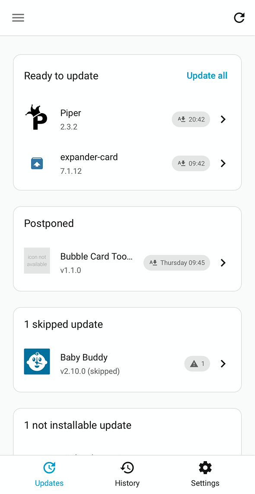
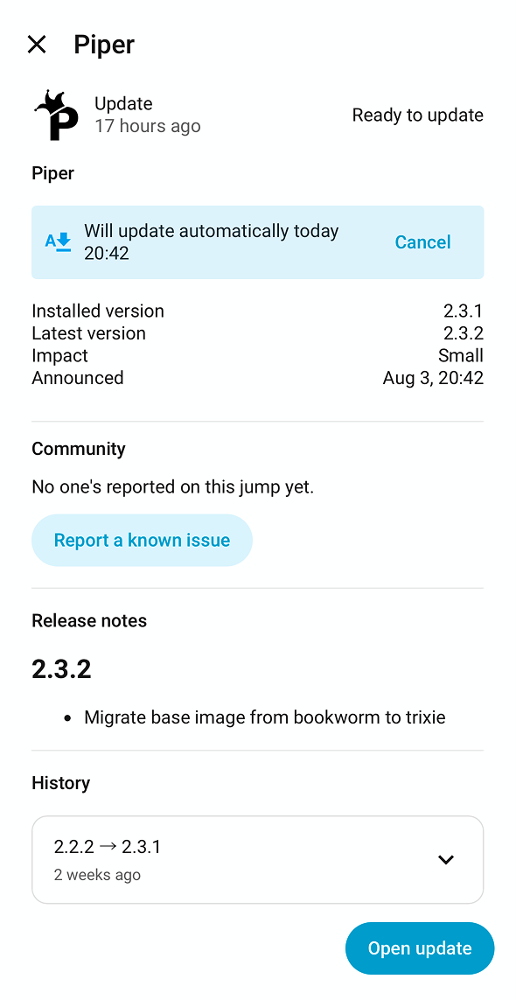
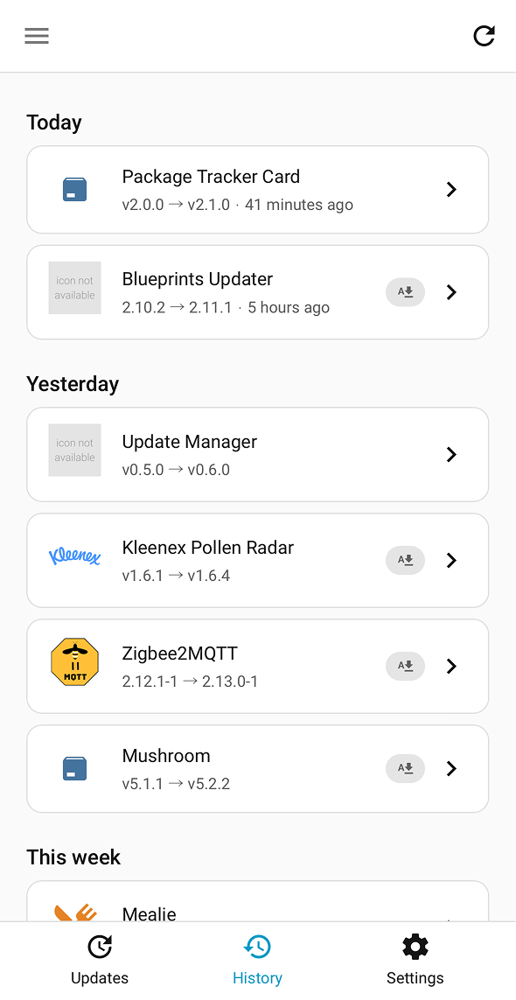

# Update Manager for Home Assistant

Updates pile up, and it's never quite obvious which ones are safe to just let happen. Update Manager
watches them for you and decides when an update has actually earned your trust: it gives a fresh release
time to prove itself, listens for anyone else who's already made the same jump and hit trouble, and
installs everything in an order that won't leave Home Assistant restarting mid-update. Turn on
auto-install and most of that becomes something you never have to think about again, all from a panel
that looks and feels like it's always been part of Home Assistant.

---

| Home | Dialog | History |
| :---:         |     :---:      |          :---: |
|   |      |     |

---

## Why you'll like it

* **A second opinion before you commit.** See whether others already made your exact jump safely, vote
  yourself, and let someone you trust override your own rules the moment they vouch for a release.
* **Nothing installs in a risky order.** Core, Supervisor, OS, and device firmware queue up to avoid a
  restart cutting off something else mid-install.
* **Zigbee devices update one at a time.** Flashing several at once floods the mesh with radio traffic
  and can destabilize it; Update Manager paces every device on the same network so that never happens.
* **A waiting period sized to the risk.** A small bump and a major Core jump don't deserve the same
  caution, so each size gets its own buffer before it counts as ready. Restrict further to specific
  weekdays or times, e.g. only ever ready on Saturdays.
* **Auto-install that still asks first.** A cancellable countdown announces what's coming, with an
  automatic backup when the update supports one, and a master switch to pause all of it in one click.
* **Release notes worth reading.** Real GitHub notes compiled across every skipped version, plus a
  wrapped app's own upstream notes (f.e. Zigbee2MQTT) alongside the short version.

---

## Installation

This integration is available via Home Assistant's built-in [Marketplace](https://contributors.home-assistant.io/marketplace/).

1. Go to the Marketplace in your Home Assistant.
2. Search for "Update Manager" and download it.
3. Restart Home Assistant.

---

## Configuration

1. Navigate to **Settings > Devices & services**, add **Update Manager**, and confirm the
   single-instance setup.
2. Open the **Update Manager** entry in the sidebar to review updates and adjust the rules (Settings
   tab).

There's nothing to fill in during setup itself; every actual setting lives on Update Manager's own
Settings tab.

## Learn more

The [Wiki](https://github.com/HA-Update-Manager/ha-update-manager/wiki) covers the rest in detail:
how auto-install actually decides, every setting explained, every sensor/event/action for your own
automations (with a ready-to-paste example), known limitations, and troubleshooting.

Found a bug? [Open an issue](https://github.com/HA-Update-Manager/ha-update-manager/issues/new/choose).
Got an idea? Same place. Have a question, or built something cool with it? Head over to
[Discussions](https://github.com/HA-Update-Manager/ha-update-manager/discussions).

## Removal

1. Go to **Settings > Devices & services**, find **Update Manager**, and remove it (the three-dot menu
   on its card, or open the entry and use Delete).
2. If you added it as a Marketplace custom repository, remove it from the Marketplace too (Integrations tab, three-dot
   menu on Update Manager's own card).

Nothing outside Home Assistant's own storage is touched by this integration (no separate service,
container, or external account changes), so there's nothing else to clean up.
